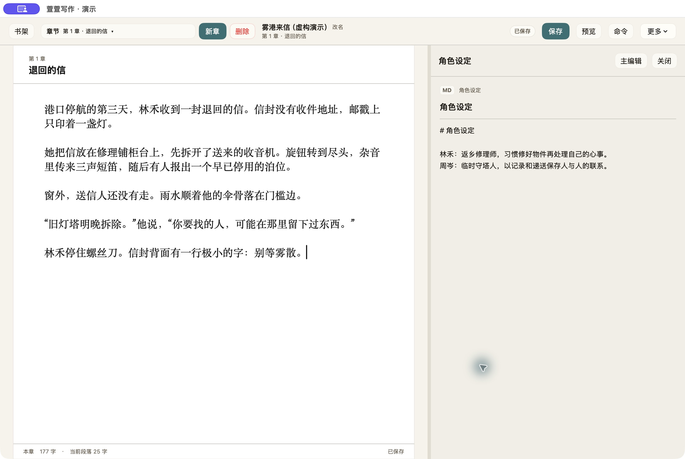
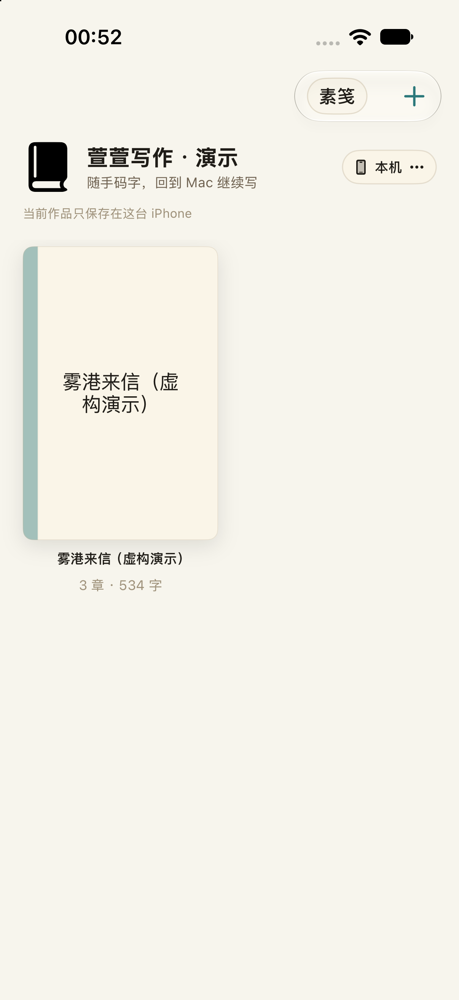

# 萱萱写作

面向中文长篇创作的 Mac / iPhone 原生写作工具：在 Mac 上整理章节、对照资料，在 iPhone 上轻量编辑，通过用户选择的文件夹衔接写作。

个人项目，借助 AI 辅助开发与迭代。应用本身不接入生成式 AI 服务。此仓库提供独立演示源码，已公开于 GitHub，尚未发布 App Store。



## 解决什么问题

长篇写作需要在正文、大纲、人物资料之间反复切换；手机和电脑也需要接续工作。本项目将章节、资料和文件存储放进同一条写作流程，采用原生文本编辑器，保留可直接访问的 Markdown / TXT 文件。

当前面向个人写作者和项目作品展示，未经规模化用户研究或商业化验证。

原项目迭代至 **v25**，保留 **27 条版本更新记录**（含小版本）；见[版本与需求迭代](docs/ITERATIONS.md)。

## 已实现

| 平台 | 功能 |
| --- | --- |
| Mac | 书架与章节管理，写作／整理／参照模式，Markdown / TXT 资料，命令搜索，中文查找替换，系统校对入口，字数统计，手机阅读预览，章节图片导出，快照 |
| iPhone | 书架、章节和资料轻编辑、延迟自动保存、手动连接文件夹 |
| 文件 | `projects.json` 索引，`projects/<作品>/drafts` 正文，`notes` 资料；两端使用相同文件约定 |

Mac 由 SwiftUI、AppKit / NSTextView、FileService 组成；iPhone 由 SwiftUI、UIKit / UITextView、MobileStore 和 XuanxuanCore 组成。两端目前仍有独立模型和读写实现，并非完全统一的业务层。没有外部包依赖。

## 快速运行

需要 macOS 14+、iOS 17+ 运行环境，以及支持相应 SDK 的 Xcode。本次验证使用 Xcode 27.1。

1. 打开 `萱萱写作.xcodeproj`。
2. Mac 选择 `萱萱写作-macOS`；手机模拟器选择 `萱萱写作-iOS`。
3. 首次运行自动复制随包的虚构示例《雾港来信》，显示三章正文、四类设定和一份 TXT 资料。
4. 真机安装需自行设置唯一 Bundle ID 和 Development Team，详见[构建与演示说明](docs/BUILD.md)。

命令行构建 Mac：

```bash
xcodebuild -project 萱萱写作.xcodeproj -scheme 萱萱写作-macOS -configuration Debug -derivedDataPath /tmp/xuanxuan-demo-build CODE_SIGNING_ALLOWED=NO build
```

命令行构建 iPhone 模拟器：

```bash
xcodebuild -project 萱萱写作.xcodeproj -scheme 萱萱写作-iOS -configuration Debug -sdk iphonesimulator -destination 'generic/platform=iOS Simulator' -derivedDataPath /tmp/xuanxuan-ios-build CODE_SIGNING_ALLOWED=NO build
```

## 演示与数据边界

默认数据位于当前用户／应用沙盒的 `Application Support/XuanxuanWritingDemo`。应用标识、设置与旧版隔离，不自动发现旧作品，也不自动连接 iCloud。示例源文件位于 `Examples/DemoWorkspace`，该目录不随编辑而修改。

首次复制即为导入示例。需要手动导入或跨设备演示时，**先复制一份** `Examples/DemoWorkspace` 到专用文件夹，再在两端选择这一份副本作为作品根目录。不要直接选择仓库内示例源目录。Mac 从作品内“更多 → 开启同步 → 选择共享文件夹”进入；iPhone 从书架同步菜单选择文件夹。连接后文件会直接写入所选目录。

跨设备时将示例副本放进 iCloud Drive，两端选择同一文件夹。当前依赖系统文件同步，没有多人协作、编辑锁或完善的冲突合并；请避免同时编辑同一章。真实设备 iCloud 同步待验证。

## 查看项目材料

- [项目案例与产品取舍](docs/PROJECT-CASE.md)
- [三版简历素材与面试准备](docs/RESUME.md)
- [验证记录与已知限制](docs/VALIDATION.md)
- [源码、素材与授权边界](docs/SOURCE-NOTES.md)




截图来自实际运行的独立演示版，仅展示虚构数据；iPhone 截图来自模拟器，不代表真机验证。

## 检查

```bash
bash scripts/smoke-test.sh
python3 scripts/check-public-tree.py
```

检查使用临时虚构数据，不操作私人作品。详细覆盖范围见验证记录。

## 后续方向

逐步收敛两端重复的模型与读写逻辑，补齐真机跨端测试和冲突提示，增加长篇文档性能基准。以上为后续计划，未计入已实现成果。

代码与本次新建示例、文档采用 MIT 许可；Apple 系统框架与 SF Symbols 遵循其各自条款。见 [LICENSE](LICENSE) 和来源说明。
